<a href="https://sangalabror.aebroyx.dev/">
  <picture><source media="(prefers-color-scheme: dark)" srcset="https://raw.githubusercontent.com/Aebroyx/aebroyx/main/generated/card_dark.svg"></picture>
</a>

<a href="https://sangalabror.aebroyx.dev/"><picture><source media="(prefers-color-scheme: dark)" srcset="https://raw.githubusercontent.com/Aebroyx/aebroyx/main/generated/button_portfolio_dark.svg"></picture></a><a href="https://www.linkedin.com/in/sangalabrorpujianto/"><picture><source media="(prefers-color-scheme: dark)" srcset="https://raw.githubusercontent.com/Aebroyx/aebroyx/main/generated/button_linkedin_dark.svg"></picture></a>

<picture><source media="(prefers-color-scheme: dark)" srcset="https://raw.githubusercontent.com/Aebroyx/aebroyx/main/generated/pacman_dark.svg"></picture>
